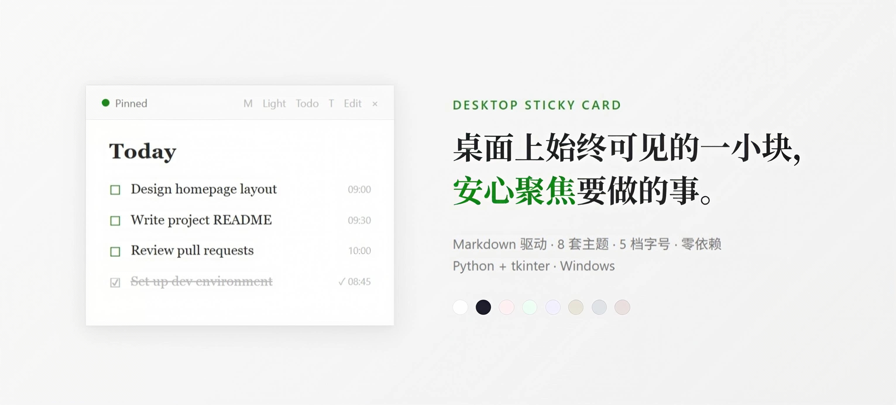

# Desktop Sticky Card

一个放在 Mac 桌面上的任务和笔记卡片。它平时待在菜单栏，鼠标移上去就会展开；也可以固定在屏幕右上角，让你随时看到接下来要做的事。

卡片内容保存在本地 Markdown 文件中。你可以直接编辑，也可以让 Agent 通过命令行添加任务和笔记。



## 能做什么

- **菜单栏展开**：鼠标移到菜单栏图标上展开，移开图标和卡片后自动收起。
- **固定显示**：点击卡片上的 `Pinned`，将卡片固定在屏幕右上角；再次点击切回悬停模式。固定状态会在重启后恢复。
- **任务与笔记**：点击待办切换完成状态；用 `All / Todo` 切换全部任务和未完成任务。卡片也能显示标题、列表和普通文字。
- **直接编辑**：点击 `Edit` 修改 Markdown，按 `Cmd + S` 保存，按 `Esc` 取消。
- **外观调整**：提供 8 套主题、5 档字号，可拖动边缘调整卡片大小。
- **截图保护**：卡片窗口使用 macOS 窗口共享限制，减少内容出现在截图中的机会。截图和录屏工具的行为可能不同，请用自己的工具确认。
- **Agent 调用**：通过 CLI 读取卡片、添加待办或追加多行笔记；安装器会同时提供可移植 Skill。
- **本地保存**：GUI 和 CLI 共用文件锁、原子写入及每日快照，内容无需上传到服务端。

## Quick start：发给你的 Agent

将下面这段话发给能在**你的 Mac 本机**运行命令的 Agent：

> 请从 https://github.com/ChenJinCloud/desktop-sticky-card 安装 Desktop Sticky Card 的 macOS 版，配置本机 CLI 和可用的 Agent Skill，然后启动卡片并验证能读取和添加测试内容。先检查安装说明；如果缺少依赖或遇到已有文件冲突，请告诉我，不要覆盖现有内容。

安装器会创建 `sticky-card` 和 `sticky-card-start` 命令，并将 Skill 链接到 Codex、Claude Code、WorkBuddy 及共享 `.agents/skills` 目录。DeepSeek Harness 和豆包工作可使用共享入口；Grok Bot 可在本机执行功能可用时调用 CLI。各 Agent 的 Skill 发现、沙箱和文件权限可能不同，云端 Agent 需要能访问这台 Mac 才能操作同一张卡片。

## 自己安装

**要求：**macOS 11 或更新版本、Git、Apple 命令行工具，以及 Python 3.8+ 和 Tk 8.6+。安装器会检查依赖，但不会自动安装它们。

在终端运行：

```bash
bash -o pipefail -c 'curl -fsSL https://raw.githubusercontent.com/ChenJinCloud/desktop-sticky-card/master/install-macos.sh | bash'
```

安装完成后启动卡片：

```bash
~/.local/bin/sticky-card-start
```

如果 `~/.local/bin` 已在 `PATH` 中，也可以直接运行 `sticky-card-start`。安装器遇到已有同名命令、Skill 或不属于该项目的安装目录时会停止，不会覆盖它们。重复运行安装器会保留已有数据，现有安装目录不会自动更新。

已有项目源码、希望手动启动或需要排查依赖时，请看 [macOS 版详细说明](mac/README.md)。

## 使用卡片

| 控件 | 作用 |
|------|------|
| `Pinned / Unpinned` | 固定在右上角 / 恢复菜单栏悬停展开 |
| `All / Todo` | 显示全部任务 / 仅显示未完成任务 |
| `T` | 显示或隐藏时间戳 |
| 主题名称 | 切换主题 |
| `XS / S / M / L / XL` | 切换字号 |
| `Edit` | 编辑 Markdown，`Cmd + S` 保存，`Esc` 取消 |
| `✕` | 收起卡片并取消固定 |

右键点击菜单栏图标，选择 `Quit Sticky Card` 可退出应用。

## 通过 CLI 操作

以下示例使用完整路径，适合 `~/.local/bin` 尚未加入 `PATH` 的环境：

```bash
# 添加待办
~/.local/bin/sticky-card add '准备本周复盘'

# 追加多行笔记
printf '## 进展\n已完成资料整理\n' | ~/.local/bin/sticky-card append --stdin

# 查看完整卡片或任务列表
~/.local/bin/sticky-card content
~/.local/bin/sticky-card show

# 完成、恢复或删除一条任务
~/.local/bin/sticky-card done 1
~/.local/bin/sticky-card undo 1
~/.local/bin/sticky-card rm 1

# 查看所有命令
~/.local/bin/sticky-card --help
```

任务编号可能随卡片内容变化；完成、恢复或删除任务前，先用 `show` 确认当前编号。`append` 保留原内容；`write` 会替换整张卡片，`clear` 会删除所有已完成任务。

## 数据保存在哪里

默认安装目录为 `~/.local/share/desktop-sticky-card`，卡片内容位于其中的 `mac/card-content.md`，窗口设置位于 `mac/.card-state.json`。GUI、CLI 和对话终端使用同一套本地存储。

应用会在 `mac/card-history/YYYY-MM-DD/` 中保存每日快照。快照记录当天首次触发时已有的文件，供恢复和追溯使用。

如果希望将数据与项目源码分开，可以在启动 GUI 和调用 CLI 前设置同一个目录：

```bash
export DESKTOP_STICKY_CARD_HOME="$HOME/.desktop-sticky-card"
```

自定义目录需要在两个入口使用一致的环境变量，否则它们会读取不同的卡片。

## Windows 版

Windows 版与 Mac 版使用不同的窗口和启动方式。功能、快捷键和启动步骤见 [Windows 版说明](README.windows.md)。

## License

[MIT](LICENSE)
